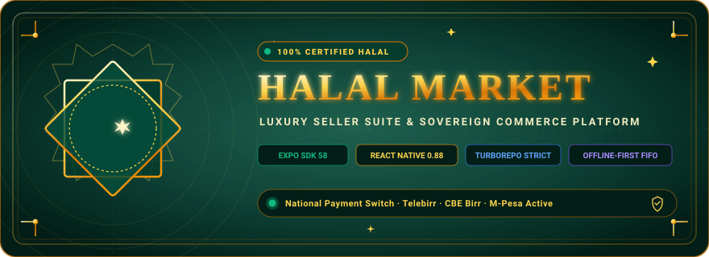
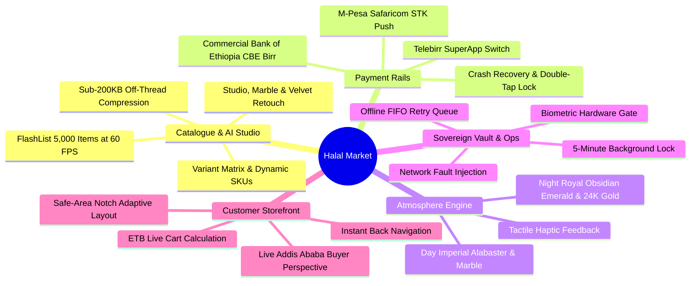
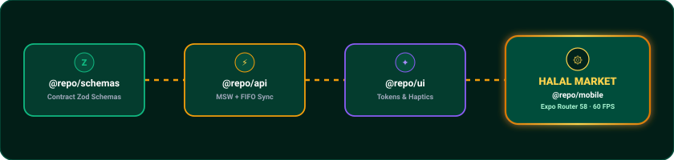
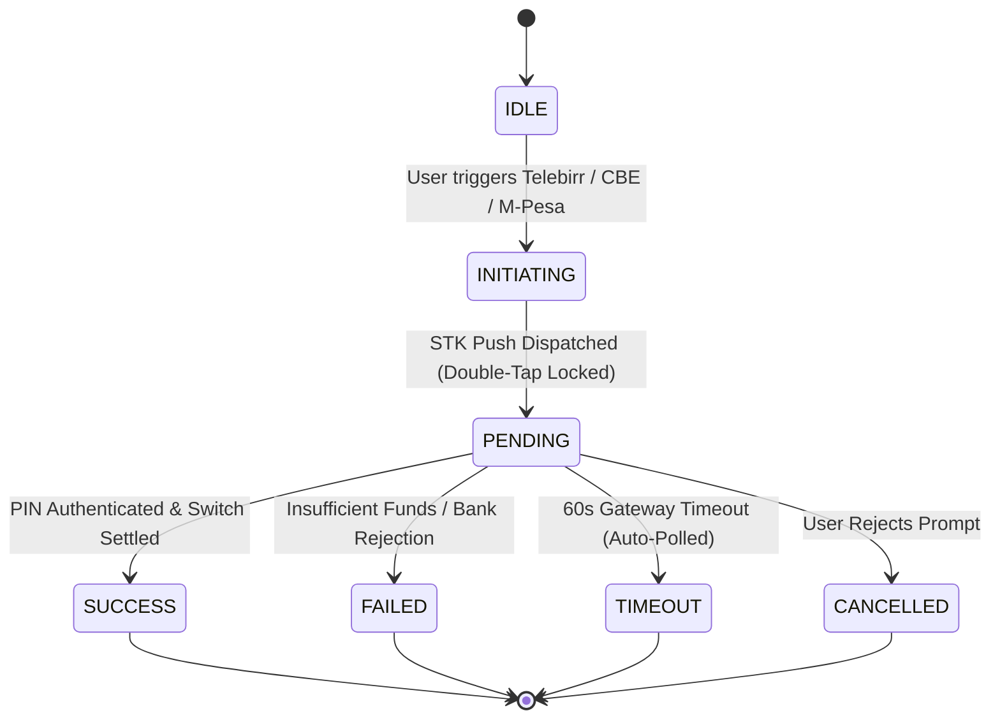

<div align="center">



<br />

# ۞ HALAL MARKET
### The Premier Certified Halal Mobile Commerce & Seller Suite
**Built with React Native 0.88 · Expo SDK 58 · Turborepo · TanStack Query · Shopify FlashList · TypeScript**

<br />

[](https://www.typescriptlang.org/)
[](https://expo.dev/)
[](https://reactnative.dev/)
[](https://turbo.build/)
[](https://shopify.github.io/flash-list/)
[](https://vitest.dev/)
[](https://en.wikipedia.org/wiki/Halal)

<br />

**Halal Market** is an enterprise-grade, contract-first mobile merchant platform engineered specifically for modern certified Halal commerce in East Africa and global markets. Featuring **real-time National Payment Switch integration** (*Telebirr*, *CBE Birr*, *M-Pesa Safaricom*), **AI Studio photo staging**, a **biometric security vault**, and a **zero-data-loss offline FIFO mutation queue**.

</div>

---

## 🌟 Executive Feature Matrix



| Domain | Capability | Architectural Implementation Highlights |
|---|---|---|
| 🕌 **Halal Catalogue & AI Studio** | Capture or pick photos, compress off-thread, and stage products with studio lighting. | Off-thread compression (`≤ 200 KB`, `≤ 1600 px`), Supabase-compatible storage client, dynamic size × color variant matrix with automated SKU generation, MMKV draft persistence, 3 AI lighting backdrops (Studio Pure, Carrara Marble, Royal Velvet), and a Shopify FlashList virtual grid rendering 5,000 items at a locked 60 FPS. |
| 📜 **Haute Order Tracking** | Live order stream, client location mapping, status filters, and timeline audit trail. | Zod-validated 6-stage order state machine (`NEW` → `ACCEPTED` → `PACKED` → `SHIPPED` → `DELIVERED` \| `CANCELLED`), 11 transition unit tests, optimistic TanStack Query cache updates with automatic rollback on network failure, customer delivery address pins, and printable packing slip generator. |
| 💳 **National Payment Switch** | Ethiopian commercial mobile money rails with instant idempotency and verification. | Typed payment state machine with simulated STK push across **Telebirr** (Ethio Telecom), **CBE Birr** (Commercial Bank of Ethiopia), and **M-Pesa** (Safaricom Ethiopia). In-flight double-tap locks, mid-pending crash recovery across app restarts, and automated transaction receipts. |
| ☀️🌙 **Atmosphere Engine** | Pro Day & Night luxury theme system with tactile haptic sensations. | Dynamic `ThemeContext` providing daylight alabaster (`#F8F9FC` / `#FFFFFF`) and deep royal emerald obsidian (`#02241C` / `#064E3B`) with 24K Sovereign Gold accents (`#F59E0B`). Instant header toggle and triple-state master switch (`Day` \| `Night` \| `System`). |
| 🔐 **Biometric Security Vault** | Cryptographic hardware authentication protecting finances and client dossiers. | `expo-local-authentication` biometric lock protecting merchant payout accounts and sensitive dossiers. Background timer automatically locks financial tabs after 5 minutes of background inactivity. |
| ⚡ **Offline-First FIFO Queue** | Guaranteed mutation delivery with zero data loss in low-connectivity areas. | Persistent FIFO mutation ledger backing stock toggles, price updates, and status transitions with client-generated UUID v4 idempotency keys, exponential backoff, and synthetic fault injection for offline resilience testing. |
| 🛍️ **Storefront Buyer View** | Live buyer perspective of the boutique with safe-area camera cutout clearance. | Modal preview rendering the customer's shopping experience, real-time cart computation in ETB, floating checkout capsule, and unblocked hardware and gesture back navigation. |

---

## 🏛️ Monorepo Architecture

<div align="center">

</div>

Managed via **Turborepo** with **pnpm workspaces** (`node-linker=hoisted`):

```
mob-app-dev/
├── packages/
│   ├── schemas/        # Contract-first Zod schemas & inferred TypeScript types
│   ├── api/            # Typed API client, MSW mocks, fixtures & offline FIFO sync engine
│   ├── ui/             # Accessible UI primitives, tokens (Day/Night), haptics, logger & charts
│   └── config/         # Shared TypeScript, ESLint 9, and NativeWind configs
├── apps/
│   └── mobile/         # Halal Market Expo Router application (Expo SDK 58, React 19)
│       ├── assets/     # High-res luxury icons (Rub el Hizb ۞ & 24K Gold Hilal)
│       ├── src/
│       │   ├── app/    # File-based routing (Tabs: Market, Orders, Catalogue, Vault)
│       │   └── features/ # Domain modules (theme, navigation, payments, storefront, camera)
│       └── scripts/    # HD icon generation suite (Pillow vector antialiasing)
└── docs/               # 17 ADRs, architecture specs, decision logs & animated assets
```

### Strict Engineering Invariants
1. **Zero `any`**: Static types are strictly derived from Zod schemas at every network, storage, deep-link, and notification boundary.
2. **Server State Partitioning**: TanStack Query owns 100% of server state using hierarchical query key factories (`queryKeys`). Server data never enters Zustand.
3. **No Client-Side Aggregations**: KPI counters, revenue calculations, and sparkline series are pre-aggregated on the server mock.
4. **Offline-First Idempotency**: All mutations carry client-generated UUID v4 idempotency keys, preventing duplicate charges or state drift.
5. **Virtualization Standard**: Shopify FlashList is utilized exclusively for all virtualized feeds (no un-virtualized `FlatList` or `ScrollView` mapped lists).
6. **Tokenized Theme Engine**: Zero raw hex codes in component files; all styling references `@repo/ui` or `useAppTheme()` tokens.

---

## 💳 Payment Gateway State Machine



---

## 🧪 Verification & Automated Tests

All packages are strictly typed and covered by automated test suites running on **Vitest 3.2**:

| Package | Test Suites | Total Tests | Status |
|---|---|---|---|
| `@repo/schemas` | 3 | 19 | ✅ 100% Passing |
| `@repo/api` | 4 | 14 | ✅ 100% Passing |
| `@repo/mobile` | 20 | 66 | ✅ 100% Passing |
| **Monorepo Suite** | **27** | **99** | **🟢 100% Green** |

### Execute Test & Quality Commands
```powershell
# Run all automated tests across monorepo
pnpm test

# Verify zero TypeScript compiler errors
pnpm --filter @repo/mobile run typecheck

# Validate bundle compilation with Metro
pnpm --filter @repo/mobile exec expo export --platform android --no-bytecode
```

---

## 🚀 Quickstart & Installation

### 1. Prerequisites
- **Node.js**: `v20+` (LTS recommended)
- **pnpm**: `v9+` or `v10+`
- **Android SDK & ADB**: Installed and configured on `PATH`

### 2. Install Dependencies
```powershell
pnpm install
```

### 3. Run Live on Connected Android Phone
If your phone is plugged in via USB (with USB Debugging enabled):
```powershell
pnpm --filter @repo/mobile run android
```

### 4. Build Standalone Android APK (EAS Cloud)
To compile a standalone release/preview APK containing the complete Halal Market production icon suite:
```powershell
pnpm build:apk
```

Once the cloud build finishes, install directly to your plugged-in device in one command:
```powershell
adb install -r "$env:USERPROFILE\Downloads\<halal-market-build>.apk"
```

---

## 🎨 Design Philosophy: Royal Emerald & 24K Sovereign Gold

```
┌────────────────────────────────────────────────────────────────────────┐
│  COLOR TOKENS & ATMOSPHERE                                             │
├────────────────────────────────────────────────────────────────────────┤
│  Primary Canvas (Day)     #F8F9FC   Pure Alabaster                     │
│  Surface (Day)            #FFFFFF   Carrara Marble                     │
│  Primary Canvas (Night)   #02241C   Royal Emerald Obsidian             │
│  Surface (Night)          #043C2E   Deep Jewel Velvet                  │
│  Sovereign Accent         #F59E0B   24K Royal Gold                     │
│  Gold Highlight           #FCD34D   Radiant Morning Star               │
│  Active Indicator         #10B981   Pure Halal Emerald                 │
│  Emblem Monogram          ۞         8-Point Rub el Hizb Geometric Star │
└────────────────────────────────────────────────────────────────────────┘
```

---

<div align="center">
  <sub>Engineered with precision for modern sovereign commerce. 100% Certified Pure.</sub>
  <br />
  <strong>Halal Market © 2026 · Addis Ababa Flagship</strong>
</div>
