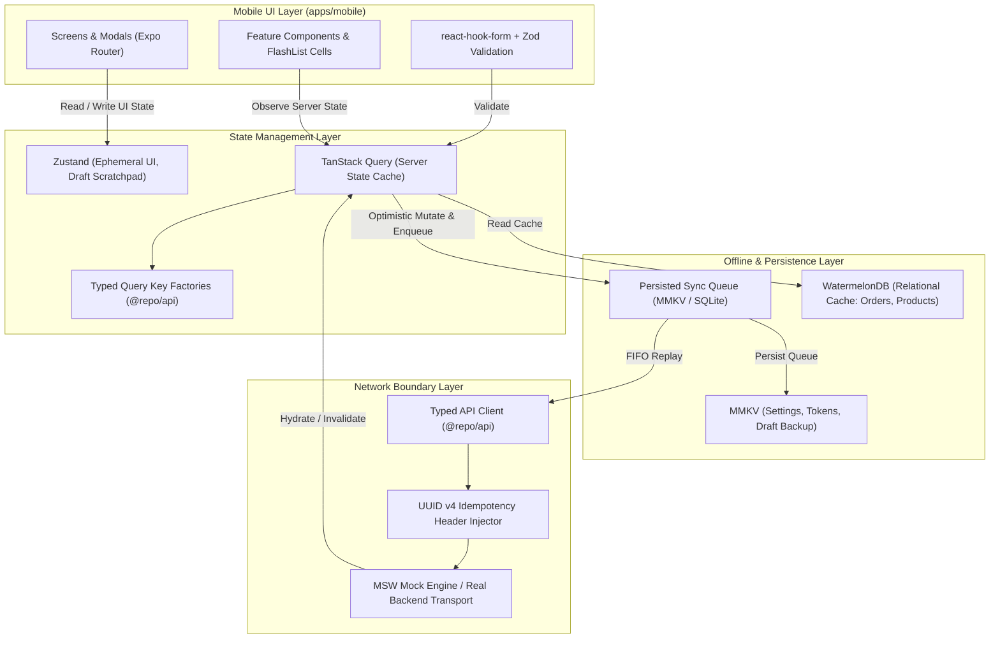

# Architecture Specification: Single-Vendor E-Commerce Seller App

## 1. System Overview & Core Philosophy

This application is an enterprise-grade mobile seller app built for independent merchants using **React Native (Expo Dev Client)**, **TypeScript**, **TanStack Query**, and **WatermelonDB/MMKV**. It operates with strict vertical feature slices, contract-first boundaries, and offline-first resilience.

### Priority Invariants
`Correctness > Resilience > Performance > Polish`

1. **Zero `any`**: All boundaries (network, storage, navigation, push) are parsed via Zod schemas into inferred static types.
2. **Strict State Partitioning**:
   - **Server State**: Managed strictly by TanStack Query. Never stored in Zustand or React Context.
   - **Client Ephemeral State**: Managed by Zustand (active filters, UI sheets, draft scratchpads).
   - **Offline Relational Cache**: Managed by WatermelonDB (orders, products, variants).
   - **Fast Key-Value Storage**: Managed by MMKV (app settings, auth tokens, draft backups).
3. **Optimistic Mutations with Rollback**: Every state mutation (stock toggle, order status, price edit) provides instant optimistic UI with snapshot rollback on failure.
4. **Offline Sync Queue**: Mutations executed while offline are persisted to an idempotent queue with exponential backoff and UUID v4 deduplication.
5. **Server-Aggregated Analytics**: No client-side aggregation of orders or revenue; all metrics and chart series arrive pre-computed from the server.

---

## 2. Monorepo & Directory Structure

```
mob-app-dev/
├── package.json                   # Monorepo root package definition
├── pnpm-workspace.yaml            # pnpm workspace definition (apps/*, packages/*)
├── pnpm-lock.yaml                 # Pinned dependencies
├── turbo.json                     # Turborepo build pipeline orchestration
├── .npmrc                         # node-linker=hoisted for Metro monorepo symlink resolution
├── docs/                          # Architecture, ADRs, Decision logs, and Runbooks
│   ├── ARCHITECTURE.md            # System architecture (this document)
│   ├── DECISIONS.md               # Assumption log
│   ├── LOOP_LEDGER.md             # Vertical slice audit trail & gate results
│   ├── SETUP.md                   # Environment setup & credentials runbook
│   ├── BLOCKERS.md                # Gate escalation ledger
│   └── ADR/                       # Architectural Decision Records (0001 - 0017)
├── packages/
│   ├── schemas/                   # Zod contracts & inferred TypeScript types
│   │   ├── package.json
│   │   ├── tsconfig.json
│   │   └── src/
│   │       ├── product.ts         # Product, SKU, variant, category schemas
│   │       ├── order.ts           # Order, line item, timeline, status transition schemas
│   │       ├── payment.ts         # M-Pesa STK push, transaction, payout schemas
│   │       ├── notification.ts    # FCM payload, deep-link action schemas
│   │       ├── dashboard.ts       # KPI, revenue series, analytics schemas
│   │       └── index.ts
│   ├── api/                       # Typed client, MSW mocks, fixtures, sync queue
│   │   ├── package.json
│   │   ├── tsconfig.json
│   │   └── src/
│   │       ├── client.ts          # Unified HTTP client with auth & idempotency headers
│   │       ├── query-keys.ts      # Hierarchical typed query key factories
│   │       ├── mocks/             # MSW handlers, deterministic fixtures, failure injector
│   │       ├── sync/              # Persistent offline mutation sync engine
│   │       └── index.ts
│   ├── ui/                        # Design tokens, primitives & accessible components
│   │   ├── package.json
│   │   ├── tsconfig.json
│   │   └── src/
│   │       ├── tokens/            # Colors, spacing, typography, radii (light/dark)
│   │       ├── components/        # Button, Input, Card, Badge, Skeleton, EmptyState
│   │       ├── i18n/              # English localization helper t()
│   │       ├── logger/            # PII-redacted structured logger
│   │       └── index.ts
│   └── config/                    # Shared tooling configs
│       ├── eslint/                # ESLint base config enforcing no-console, strict rules
│       ├── typescript/            # Base tsconfigs (strict, noUncheckedIndexedAccess)
│       └── tailwind/              # Shared NativeWind/Tailwind presets
└── apps/
    └── mobile/                    # Expo Router application workspace
        ├── app.json               # Expo config plugins, EAS build settings, CNG
        ├── package.json
        ├── tsconfig.json
        ├── babel.config.js
        ├── tailwind.config.js
        └── src/
            ├── app/               # Expo Router file-based routes
            │   ├── _layout.tsx    # Root layout (QueryProvider, AuthGate, SyncBanner)
            │   ├── (auth)/        # Sign in, biometric lock screen
            │   ├── (tabs)/        # Tab navigation: Dashboard, Orders, Products, Ops
            │   ├── orders/        # Order detail [id].tsx, timeline modal
            │   ├── products/      # Product create/edit [id].tsx, photo camera modal
            │   └── payouts/       # Financial screens protected by biometric gate
            ├── features/          # Feature-sliced screens, hooks & domain logic
            │   ├── products/      # Product hooks, FlashList items, draft store
            │   ├── orders/        # Order hooks, status state machine, timeline
            │   ├── payments/      # M-Pesa STK push state machine & receipt modal
            │   ├── notifications/ # FCM handler, deep-link router, dev harness
            │   ├── dashboard/     # KPI cards, Skia revenue chart
            │   └── auth/          # Biometric gate, SecureStore session
            └── db/                # WatermelonDB models, migrations, and MMKV instance
```

### Rationale
- **`packages/schemas`**: Single source of truth. Prevents contract drift between UI forms, API mocks, and database storage.
- **`packages/api`**: Encapsulates network operations, query key factories, offline sync queue, and deterministic MSW mocks. Switching from mock to live backend is done here by toggling the transport adapter.
- **`packages/ui`**: Prevents design fragmentation. Enforces strict zero-hex styling rule by consuming theme tokens.
- **`apps/mobile`**: Pure consumer of packages. Organizes routes using Expo Router and organizes feature components into clean vertical slices.

---

## 3. Layering & Data Flow



### Invariants:
1. **No Server State in Zustand**: Zustand stores only UI filter choices (e.g. status filter dropdown, search term query string), draft form scratchpads, and ephemeral modal visibility.
2. **Boundary Validation**: Every external input (API JSON, deep-link params, notification data, MMKV persisted string) passes through Zod `.safeParse()` before application logic touches it.
3. **No Uncompressed Uploads**: Images captured via VisionCamera or picked from gallery are compressed off the JS thread (`react-native-compressor`) before being queued for upload.

---

## 4. Offline Sync Engine & Idempotency Design

### Mutation Lifecycle
1. **User Action**: The user toggles stock or transitions an order status.
2. **Optimistic Cache Patch**: TanStack Query `onMutate` cancels active queries for the entity, snapshots the previous state, applies the patch immediately to the in-memory cache, and writes to WatermelonDB.
3. **Queue Enqueue**: An immutable mutation payload is written to the persistent sync queue with:
   - `id`: Job ID
   - `idempotencyKey`: UUID v4 (reused on all retries)
   - `type`: `ORDER_STATUS_UPDATE` | `PRODUCT_STOCK_TOGGLE` | `PRODUCT_PRICE_UPDATE` | `PRODUCT_CREATE`
   - `endpoint`: Target REST path
   - `payload`: Structured JSON payload
   - `timestamp`: Creation ISO timestamp
   - `status`: `pending` | `processing` | `failed` | `settled`
   - `retryCount`: Number of attempts
   - `lastAttemptAt`: Timestamp
4. **Execution / Dispatch**:
   - If device is **online**: The worker immediately flushes the mutation via the typed API client.
   - If device is **offline**: The mutation remains in the queue. UI renders a global sync badge indicating `N pending offline actions`.
5. **Reconnection & Flush**:
   - The sync worker observes network status. On reconnection, mutations are dispatched sequentially (FIFO).
   - If a mutation fails with a transient error (e.g. 503, timeout), exponential backoff with jitter is applied: `wait = min(30000, 1000 * 2^retryCount + random(0, 500))`.
   - If a mutation encounters a permanent rejection (e.g. 400 Bad Request / 409 Conflict), the optimistic state is rolled back, the user is alerted with an explanatory toast, and the job is marked `failed` in the audit log.

---

## 5. Multi-Vendor Seam Specification

### Locked Requirement
The application operates in **single-vendor** mode for this MVP release, but the data schema, payout settlement engine, and API boundaries are architected to support multi-vendor split payouts without breaking schema changes.

### Seam Architecture

#### 1. Schema Scoping (`packages/schemas`)
Every core entity contains an explicit `vendorId` field:
```typescript
// packages/schemas/src/common.ts
export const VendorScopeSchema = z.object({
  vendorId: z.string().default('vdr_primary_store'),
});

// Products, Orders, and Payouts inherit VendorScopeSchema
export const ProductSchema = z.object({
  id: z.string(),
  vendorId: z.string(), // Default: 'vdr_primary_store'
  title: z.string(),
  price: z.number(),
  // ...
});
```

#### 2. Split Settlement Model
Order line items and payouts model split accounting:
```typescript
export const OrderLineItemSchema = z.object({
  id: z.string(),
  productId: z.string(),
  vendorId: z.string(),
  unitPrice: z.number(),
  quantity: z.number(),
  subtotal: z.number(),
  commissionRate: z.number().default(0.0), // Platform cut (0 in single vendor)
  netVendorAmount: z.number(),             // subtotal - commission
});

export const PayoutBatchSchema = z.object({
  id: z.string(),
  vendorId: z.string(),
  grossSales: z.number(),
  platformFee: z.number().default(0),
  netPayout: z.number(),
  status: z.enum(['pending', 'processing', 'completed', 'failed']),
  recipientMsisdn: z.string(),
});
```

#### 3. Transition Path to Multi-Vendor (Zero Rewrite)
1. **Network Header**: In single-vendor mode, the API client sends `X-Vendor-ID: vdr_primary_store` automatically. When upgrading to multi-vendor, a vendor selector context provides the active `vendorId`.
2. **Order Splitting**: Multi-item orders spanning multiple vendors can be grouped by `vendorId` at settlement time using the existing `OrderLineItemSchema.vendorId` without changing table structures.
3. **Payout Segregation**: The payout engine processes batches partitioned by `vendorId`. In single-vendor mode, the query returns 1 batch; in multi-vendor mode, it returns N batches.
